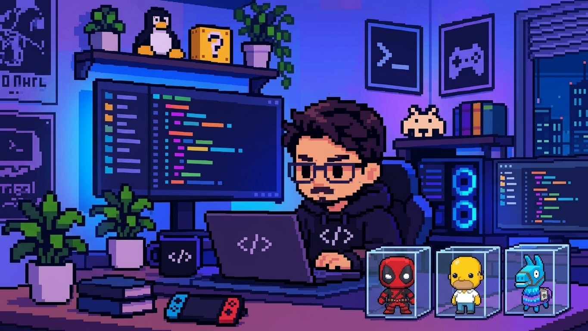
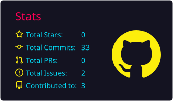
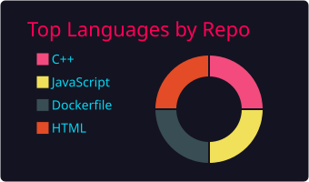

<!-- Paleta neon: cian 00F0FF · magenta FF2BD6 · violeta 7B2FFF · verde 39FF14 · fondo 0D0B2A -->

  

<h1 align="center">Hola 👋 Soy Felipe</h1>

  

  
  
  

---

## Sobre mí

- 🎓 Ingeniero Civil en Informática
- 🐧 Fan de la terminal
- 🎮 Gamer: Nintendo Switch, retro y coleccionista de figuras
- 📫 Contacto: **felipeignacio.fibl@gmail.com**

## Lenguajes y Herramientas

  

## Estadísticas

  
  

  

